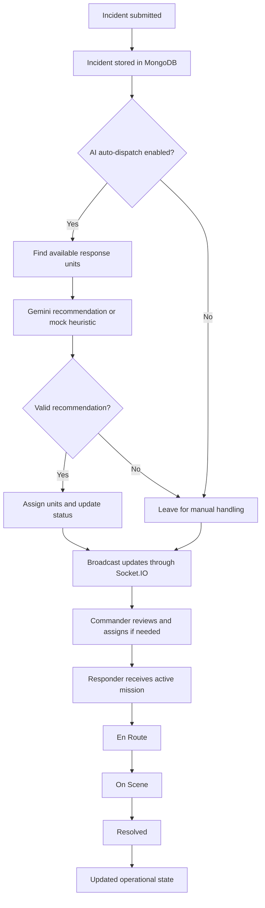
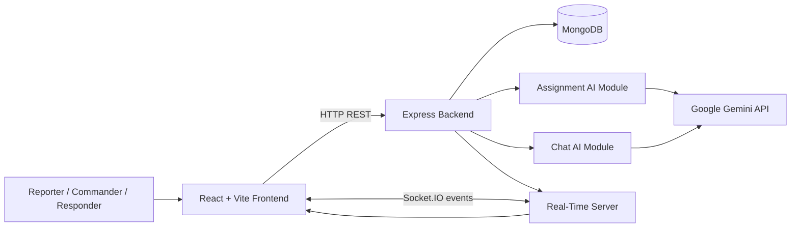

# SpiderSense

### AI-Assisted Emergency Response & Real-Time Dispatch Platform

**SpiderSense** is a full-stack emergency-response simulation platform that connects incident reporting, AI-assisted responder assignment, live operational updates, geospatial monitoring, and mission-status tracking in one command interface.

It uses a superhero command-center concept to make emergency coordination easier to understand and demonstrate. Citizens can report incidents, commanders can monitor and assign response units, and responders can track active missions and update their progress.

  <a href="https://spidersense-u0wc.onrender.com/"><strong>🚀 Live Demo</strong></a>
  ·
  <a href="https://github.com/bhav-1007/SpiderSense"><strong>📂 Source Code</strong></a>

> **Project status:** Portfolio/demo project. SpiderSense is not an official emergency-services system and must not be used to coordinate real emergencies.

---

## Table of Contents

- [The Problem](#the-problem)
- [The Solution](#the-solution)
- [Key Features](#key-features)
- [User Roles](#user-roles)
- [Incident Lifecycle](#incident-lifecycle)
- [How AI Dispatch Works](#how-ai-dispatch-works)
- [System Architecture](#system-architecture)
- [Technology Stack](#technology-stack)
- [Data Model](#data-model)
- [API Overview](#api-overview)
- [Real-Time Events](#real-time-events)
- [Security and Demo Limitations](#security-and-demo-limitations)
- [Author](#author)

---

## The Problem

Emergency-response coordination involves several connected tasks: capturing an incident report, understanding its severity and location, selecting suitable response units, communicating assignments, and tracking progress.

When these activities are handled through disconnected interfaces, operators can lose visibility into the current situation and responders may not have a clear view of their assignments.

## The Solution

SpiderSense brings these workflows into one interactive application:

- A reporting interface for submitting incidents.
- A command dashboard for monitoring incidents and response units.
- AI-assisted recommendations for selecting available responders.
- A live map for visualising incident and unit locations.
- Real-time state synchronisation using Socket.IO.
- A responder interface for progressing through mission statuses.
- An analytics view for operational monitoring.
- A J.A.R.V.I.S.-inspired AI assistant that can answer questions using current incident and unit context.

The goal is to demonstrate how a modern web application can combine a persistent data layer, real-time events, AI-assisted decisions, and role-oriented interfaces into a coherent operational workflow.

---

## Key Features

### 1. Incident Reporting

- Submit incidents with a title, type, severity, and location.
- Persist reports in MongoDB.
- Generate incident identifiers and reference codes.
- Track submitted incidents through a mission-status timeline.
- Display the status of a user's submissions during the current session.

### 2. AI-Assisted Responder Assignment

- Evaluate available response units against an incident.
- Consider incident type, severity, unit specialisation, battery level, and geographic proximity.
- Use Google Gemini to generate recommended unit IDs and an explanation when a valid API key is configured.
- Validate returned unit IDs against the available-unit list before applying recommendations.
- Provide a deterministic heuristic-based mock mode when the Gemini key is unavailable.
- Allow assignments to be handled manually or overridden by the commander.
- Record whether an assignment originated from AI auto-dispatch, a manual assignment, or a commander override.

**Important:** The mock mode is a local scoring heuristic, not an AI model. Assignment recommendations are intended for demonstration and require human oversight in any realistic operational design.

### 3. Real-Time Operations

- Use Socket.IO to broadcast incident, unit, and dispatch-setting changes.
- Synchronise incident and unit state across connected clients.
- Reflect new reports and operational updates without requiring a full page refresh.
- Combine REST endpoints for commands and persistence with WebSocket events for live updates.

### 4. Geospatial Monitoring

- Display incident markers and responder locations on an interactive Leaflet map.
- Visualise the geographic context of active assignments.
- Show the assigned responder's location and mission on the responder interface.
- Use latitude and longitude as part of the assignment-matching logic.

Map locations in the demo include seeded example coordinates and should not be interpreted as live tracking of real people or emergency vehicles.

### 5. Commander Dashboard

- View incidents and response units from a central interface.
- Monitor incident severity and lifecycle status.
- Assign units to incidents and change assignments.
- Override AI-generated assignments.
- Toggle the AI auto-dispatch setting.
- Manage response-unit availability and operational status.
- Access the analytics page for operational metrics.

### 6. Responder Mission Console

- View the responder unit's current assignment.
- See the incident title, reference code, and location.
- Progress through the mission states: **Dispatched → En Route → On Scene → Resolved**.
- Update unit status as the mission progresses.
- Toggle duty availability when the unit is not actively handling a mission.
- View the assignment and unit on a map.

### 7. AI Tactical Assistant

- Ask questions through the chat endpoint.
- Provide the assistant with current incident and unit context.
- Support questions about active incidents, unit availability, and how the platform works.
- Use Gemini when configured and return a clearly labelled mock response when no valid API key is available.

The assistant is a contextual demo feature, not a verified source of emergency advice.

### 8. Analytics and Interface Design

- Provide a dedicated analytics page for operational visibility.
- Use Recharts for data visualisation.
- Use Framer Motion for interface transitions and feedback animations.
- Use Lucide icons and a tactical command-centre visual style.
- Include distinct reporting, commander, responder, and analytics experiences.

---

## User Roles

| Role | Primary responsibilities |
|---|---|
| **Citizen / Reporter** | Submit incidents and follow the status of reports made during the current session. |
| **Commander** | Monitor operations, manage units, assign responders, override assignments, and control auto-dispatch. |
| **Responder** | View an active mission, update its progress, and manage duty status. |

The interface includes role-specific navigation and page routing. **The current repository contains demo-oriented authentication behavior; see [Security and Demo Limitations](#security-and-demo-limitations) before treating these roles as production access controls.**

---

## Incident Lifecycle

The diagram describes the intended application workflow. Exact behavior depends on the configured AI provider, available units, and current application state.

---

## How AI Dispatch Works

1. **Receive an incident.** The backend stores the incident, including its type, severity, title, and location.
2. **Find eligible units.** When auto-dispatch is enabled, the backend retrieves active units whose status is `available`.
3. **Generate a recommendation.**
   - With a valid `GEMINI_API_KEY`, the backend asks Google Gemini to recommend suitable units and provide reasoning.
   - Without a valid key, a heuristic ranks units using incident-type matching, battery level, and approximate coordinate distance.
4. **Validate the recommendation.** Returned unit IDs are filtered against the eligible units supplied to the assignment function.
5. **Apply the assignment.** When a recommendation is accepted, the incident is marked as dispatched and the selected units are updated.
6. **Broadcast state changes.** Socket.IO events inform connected clients of updated incidents and unit states.
7. **Allow human intervention.** The commander can manually assign units or override an AI-generated assignment.

This is AI-assisted decision support, not a routing engine or a guarantee of optimal emergency response. The current implementation uses a simple coordinate-distance heuristic in mock mode; it does not calculate real road-network travel times.

---

## System Architecture

SpiderSense follows a client-server architecture with a React frontend, an Express API, MongoDB persistence, an AI integration layer, and Socket.IO for real-time communication.

### Architectural responsibilities

| Component | Responsibility |
|---|---|
| **React frontend** | Role-specific pages, interactive maps, forms, dashboard views, and user interactions. |
| **Store context** | Shared client-side incident/unit state, current demo user, and API actions. |
| **Axios** | HTTP communication between frontend and backend. |
| **Express API** | Incident creation, state retrieval, assignment changes, unit status updates, settings, login, and AI chat endpoints. |
| **Socket.IO** | Broadcast state changes to connected clients. |
| **MongoDB + Mongoose** | Persist incident and response-unit records. |
| **Assignment AI module** | Generate Gemini-backed recommendations or mock heuristic suggestions. |
| **Chat AI module** | Generate contextual assistant responses using current system data. |
| **Leaflet / React-Leaflet** | Map rendering and geographic visualisation. |
| **Recharts** | Analytics visualisation. |
| **Framer Motion** | Transitions and interaction feedback. |

---

## Technology Stack

| Layer | Technologies |
|---|---|
| Frontend framework | React 18, Vite |
| Styling | Tailwind CSS, PostCSS |
| UI and animation | Framer Motion, Lucide React |
| Maps | Leaflet, React-Leaflet |
| Charts | Recharts |
| HTTP client | Axios |
| Real-time communication | Socket.IO client and server |
| Backend | Node.js, Express |
| Database | MongoDB Atlas, Mongoose |
| AI integration | Google Generative AI SDK / Gemini |
| Authentication-related utilities | bcrypt |
| Validation and request protection | express-validator, express-rate-limit |
| Logging | Pino |
| Configuration | dotenv |
| Code quality | ESLint / project linting configuration |

---

## Data Model

The backend defines two principal MongoDB models.

### Response Unit (`Hero`)

Represents a responder or superhero unit.

| Field | Purpose |
|---|---|
| `id` | Application-level unit identifier |
| `name` | Responder's name |
| `callSign` | Display name used in the command interface |
| `username` | Unit login identifier |
| `password` | Password field; newly created units are stored using bcrypt hashing |
| `type` | Unit specialisation, such as medical, fire, hazmat, tactical, or air |
| `members` | Unit size |
| `battery` | Example readiness/battery indicator |
| `status` | Availability or mission state |
| `isActive` | Whether the unit is active |
| `location` | Latitude, longitude, and optional label |

### Incident (`Incident`)

Represents an incident submitted to the platform.

| Field | Purpose |
|---|---|
| `id` | Application-level incident identifier |
| `code` | Human-readable incident reference |
| `title` | Incident summary |
| `type` | Incident category |
| `severity` | Critical, high, moderate, or low |
| `status` | Unassigned, dispatched, en route, on scene, or resolved |
| `assignedUnitIds` | Units currently assigned to the incident |
| `suggestedUnitIds` | Units recommended by the AI assignment flow |
| `aiReasoning` | Explanation returned by the recommendation module |
| `assignmentSource` | AI auto-dispatch, commander override, or manual assignment |
| `location` | Geographic coordinates and label |
| `reportedAt` / `updatedAt` | Incident timestamps |
| `reporter` | Source label for the report |

The `Hero` and `Incident` models are linked through application-level unit IDs rather than a Mongoose ObjectId relationship.

---

## API Overview

The backend exposes REST endpoints for the core operational workflow.

| Method | Endpoint | Purpose |
|---|---|---|
| `GET` | `/api/state` | Retrieve incidents and units. |
| `GET` | `/api/settings` | Retrieve the AI auto-dispatch setting. |
| `PATCH` | `/api/settings/ai-auto-dispatch` | Enable or disable AI auto-dispatch. |
| `POST` | `/api/heroes` | Create a response unit. |
| `POST` | `/api/login` | Demo responder login lookup. |
| `POST` | `/api/incidents` | Create an incident and optionally run auto-dispatch. |
| `PATCH` | `/api/incidents/:id/status` | Update an incident's status. |
| `PATCH` | `/api/incidents/:id/assign` | Assign units to an incident. |
| `PATCH` | `/api/units/:id/status` | Update a unit's status or active flag. |
| `POST` | `/api/chat` | Request a contextual AI assistant response. |

This is a high-level overview of the routes visible in the backend source, not a complete API specification. Request schemas, authorization requirements, response examples, and error behavior should be documented and tested before the API is used beyond the demo.

---

## Real-Time Events

The client listens for Socket.IO events to keep its local view synchronised.

| Event | Purpose |
|---|---|
| `sync:state` | Replace the local incident and unit state with a server snapshot. |
| `incident:created` | Add a newly reported incident. |
| `incident:updated` | Update an incident record. |
| `unit:updated` | Update one unit. |
| `unit:updated_many` | Replace the unit collection after bulk changes. |
| `settings:ai-auto-dispatch` | Synchronise the auto-dispatch setting. |

The backend emits these events after relevant operations so connected clients can reflect changes without repeatedly polling the API.

---

## Security and Demo Limitations

SpiderSense is a portfolio/demo application, not a production-ready emergency dispatch service. A review of the current backend reveals important limitations that should be addressed before any real-world use:

- **Demo login behavior:** The `/api/login` route looks up a unit by ID and returns its record without validating the submitted password. The frontend also has role-oriented demo login behavior. Do not describe the current implementation as production-secure authentication.
- **Authorization:** Sensitive routes, including unit creation, assignment changes, status updates, and dispatch-setting changes, need server-side authentication and role-based authorization checks.
- **CORS:** The Socket.IO server currently allows `*`; production origins should be restricted. Review the Express CORS configuration as well.
- **Credential handling:** New unit passwords are hashed with bcrypt, but the login route does not currently verify them. Seeded demo accounts also use example credentials in the source.
- **Input validation:** Some validation exists for unit creation, but all mutation endpoints should validate allowed values, IDs, types, and ownership before updating records.
- **Dispatch consistency:** Assignment and status transitions should be validated atomically to avoid assigning a unit that is no longer available or leaving unit and incident statuses inconsistent.
- **AI reliability:** AI output must be treated as untrusted input. Validate all recommended IDs and business rules on the server before changing operational state.
- **Privacy and reliability:** A real deployment would require audit logs, monitoring, rate limiting appropriate to each route, secret management, backups, failure recovery, and a documented data-retention policy.

These limitations are stated intentionally. Clear boundaries make the project more credible than unsupported claims of complete security or guaranteed response performance.

---

## Author

**Bhavesh Bhatera**  
IIIT Bhubaneswar · Electronics and Communication Engineering

- **GitHub:** [bhav-1007](https://github.com/bhav-1007)
- **Project repository:** [SpiderSense](https://github.com/bhav-1007/SpiderSense)
- **Live demo:** [spidersense-u0wc.onrender.com](https://spidersense-u0wc.onrender.com/)

---

  <strong>SpiderSense — From incident reporting to coordinated response.</strong>

